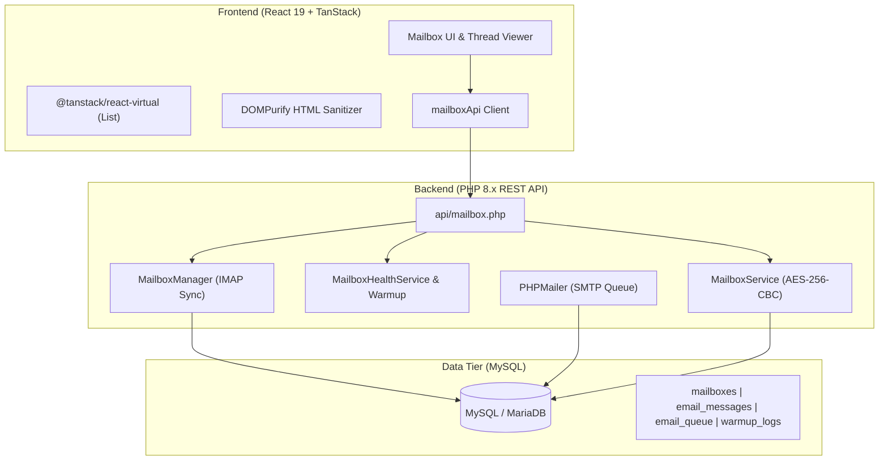

# 📬 AI Mailbox Pro

A modern, high-performance, self-hosted full-stack email client, multi-account manager, and deliverability warmup engine built with **React 19**, **TanStack Query/Virtual**, **Tailwind CSS**, and **PHP 8+ / MySQL**.

---

## ✨ Features

- **Multi-Account Support**: Manage and toggle between multiple IMAP/SMTP mailboxes with capsule tabs and individual health monitoring.
- **Infinite Virtualized Threads**: Powered by `@tanstack/react-virtual`, smoothly scrolling through thousands of messages without DOM bloat.
- **Deliverability & 28-Day Warmup Engine**:
  - Automated 28-day ramp-up schedule (5 → 12 → 25 → 35 → 40 emails/day).
  - Rolling bounce rate calculations with automatic threshold tripwires (auto-pause on >2% bounce rate).
  - Daily sending quotas to protect your domain reputation.
- **Enterprise Cryptography & Security**:
  - Mailbox credentials stored with **AES-256-CBC** and SHA-256 key derivation.
  - Inbound HTML email sanitization using **DOMPurify** to neutralize XSS vectors.
  - CSRF protection and prepared PDO statements across all backend endpoints.
- **AI Drafts & HITL (Human-in-the-Loop) Flow**:
  - Review AI-generated response drafts.
  - Edit and approve drafts with 1-click promotion to the background delivery queue.
- **Asynchronous Queue & Ingestion**:
  - Standalone cron runners for background IMAP synchronization and SMTP queue dispatching.

---

## 🏛️ Architecture Overview



---

## 📁 Project Structure

```text
ai-mailbox/
├── backend/
│   ├── api/
│   │   └── mailbox.php             # REST API Controller
│   ├── classes/
│   │   ├── MailboxManager.php      # IMAP message syncing & MIME parser
│   │   └── EmailVerifier.php       # DNS & syntax validation engine
│   ├── cron/
│   │   ├── sync_mailbox.php        # Inbound email ingest cron
│   │   └── process_mail_queue.php  # Outbound SMTP queue processor
│   ├── libs/
│   │   └── PHPMailer/              # SMTP transmission engine
│   ├── services/
│   │   ├── MailboxService.php      # Account CRUD & AES encryption
│   │   ├── MailboxHealthService.php# Deliverability monitoring
│   │   └── WarmupService.php       # 28-day ramp-up schedule
│   ├── config.php                  # Environment loader & security headers
│   ├── db.php                      # PDO MySQL connector
│   └── .env.example                # Sample backend config
├── database/
│   └── schema.sql                  # Complete MySQL schema & indexes
├── frontend/
│   ├── src/
│   │   ├── components/
│   │   │   ├── mailbox/
│   │   │   │   └── AdminMailbox.tsx# Core Mailbox Component
│   │   │   └── ui/                 # Shadcn UI primitives
│   │   ├── lib/
│   │   │   ├── api.ts              # Fetch API client
│   │   │   └── utils.ts            # Class merging utilities
│   │   ├── App.tsx                 # Main application view
│   │   ├── main.tsx                # Entry point
│   │   └── index.css               # Tailwind CSS theme
│   ├── index.html
│   ├── package.json
│   ├── tsconfig.json
│   └── vite.config.ts
├── .gitignore
├── LICENSE
└── README.md
```

---

## 🚀 Quick Start Guide

### 1. Database Setup
1. Create a MySQL database (e.g., `ai_mailbox_db`).
2. Import the schema file located in `database/schema.sql`:
   ```bash
   mysql -u root -p ai_mailbox_db < database/schema.sql
   ```

### 2. Backend Configuration
1. Navigate to the `backend/` directory:
   ```bash
   cd backend
   cp .env.example .env
   ```
2. Configure `.env` with your database credentials and a 32-character encryption key:
   ```env
   DB_HOST=127.0.0.1
   DB_PORT=3306
   DB_NAME=ai_mailbox_db
   DB_USER=root
   DB_PASS=your_db_password
   ALLOWED_ORIGIN=http://localhost:5173
   ENCRYPTION_KEY=generate_a_random_32_character_key_here
   ```

### 3. Frontend Setup
1. Navigate to the `frontend/` directory:
   ```bash
   cd ../frontend
   npm install
   ```
2. Start the Vite development server:
   ```bash
   npm run dev
   ```
3. Open `http://localhost:5173` in your browser.

---

## ⏱️ Background Cron Setup

To enable automated background email polling and outbound sending, add the following cron jobs on your server:

```bash
# Ingest inbound emails via IMAP every 2 minutes
*/2 * * * * php /path/to/backend/cron/sync_mailbox.php > /dev/null 2>&1

# Dispatch outbound queue via SMTP every 1 minute
* * * * * php /path/to/backend/cron/process_mail_queue.php > /dev/null 2>&1
```

---

## 🔒 Security Best Practices

- **Never commit `.env`**: Credentials are strictly read from environment variables.
- **Generate Strong Encryption Keys**: Ensure `ENCRYPTION_KEY` in `.env` is a high-entropy string (e.g. `openssl rand -base64 32`).
- **PHP IMAP Extension**: Ensure `php_imap` and `php_openssl` are enabled in your `php.ini`.

---

## 📄 License

This project is open-source software licensed under the [MIT License](LICENSE).
